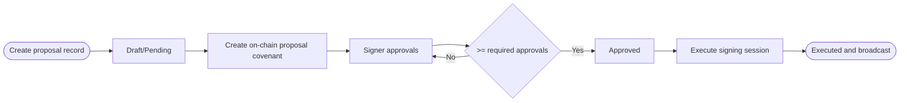

A spending proposal routes a payout through an approval and execution flow. The product currently splits that lifecycle into:

- Off-chain metadata + signer tracking in SQLite
- On-chain proposal covenant deployment and execution

## Full Lifecycle



## Create a Proposal

<Steps>
  <Step title="Navigate to Proposals">
    Go to **Vault → Proposals → Create Proposal**, or navigate to your vault and click **New
    Proposal**.
  </Step>
  <Step title="Define payout details">
    - **Recipient**: BCH P2PKH address that will receive funds - **Payout Amount**: BCH amount to
    transfer - **Reason**: short payout rationale stored with the proposal record
  </Step>
  <Step title="Submit">
    This creates the proposal record with `POST /api/vaults/:vaultId/proposals`. Then fund the
    on-chain proposal covenant with: `POST /api/:id/create-onchain` and `POST
    /api/:id/confirm-create`.
  </Step>
</Steps>

## Approve a Proposal

Each signer clicks **Approve** in the proposal UI.

- Build approval tx: `POST /api/:id/approve-onchain`
- Confirm approval: `POST /api/:id/confirm-approval`

Once approvals reach the required threshold, status transitions to `approved`.

## Execute a Proposal

Execution uses a 2-signer session:

- Start session: `POST /api/proposals/:id/execute`
- Submit each signer's signed copy: `POST /api/proposals/:id/execute-signature`

In the app, an approved request shows **Send payment** to its signers. Two of them approve sending in their wallets. The first signer sees that the payment waits for the second; when the second signs, the backend combines both signatures into one transaction, broadcasts it, and marks the request executed.

## Current API Scope

Proposal covenant functions such as `cancel()` and `expire()` exist at contract level, but the public HTTP workflow currently focuses on create, approve, and execute.

## API

```bash
POST /api/vaults/:vaultId/proposals
POST /api/proposals/:id/create-onchain
POST /api/proposals/:id/confirm-create
POST /api/proposals/:id/approve-onchain
POST /api/proposals/:id/confirm-approval
POST /api/proposals/:id/execute
POST /api/proposals/:id/execute-signature
DELETE /api/proposals/:id
```
